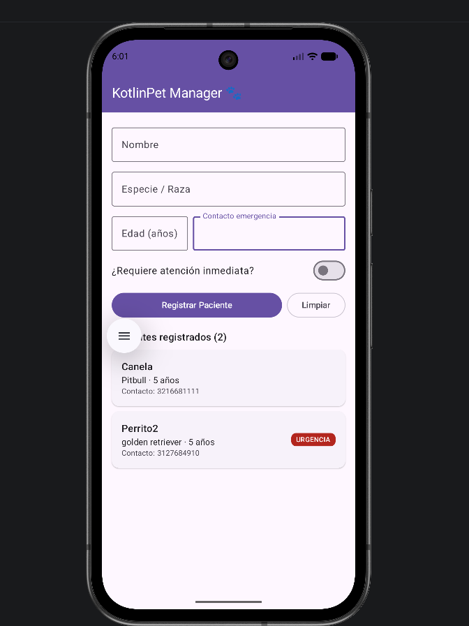

# KotlinPet Manager 🐾

**Estudiante:** Alejandro Arbeláez Molina
**Código:** 1092852144

## Descripción
KotlinPet Manager 🐾 es una app Android para clínicas veterinarias que permite registrar pacientes con nombre, especie, edad, contacto de emergencia y prioridad, y verlos al instante en una lista de tarjetas. Desarrollada con Jetpack Compose, Material 3 y arquitectura MVVM, separa la lógica en un ViewModel que valida los datos y actualiza la interfaz.

## Arquitectura (MVVM)
- `model/` → `Paciente` (data class)
- `viewmodel/` → `PacienteViewModel` (estado, validación, registro y limpieza del formulario)
- `ui/` → pantalla y componentes en Jetpack Compose (View)

## Tecnologías
- Kotlin + Jetpack Compose
- Material 3
- Git y GitHub

## Captura de la app en ejecución

